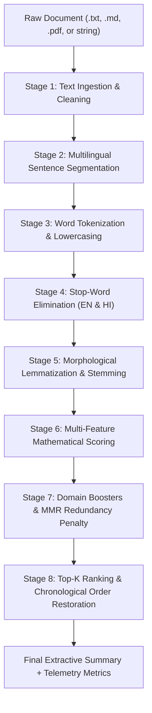

# Complete NLP Pipeline Documentation

## Intelligent Extractive Text Summarization System (CRUX)

---

### 1. Executive Summary & Philosophy

CRUX implements an **interpretability-first, deterministic, 100% extractive NLP pipeline**. Unlike generative Large Language Models (LLMs) that risk hallucinating facts, CRUX extracts verbatim sentences directly from source documents using mathematical term weighting, position heuristics, high-stakes domain boosters, and chronological sequence restoration.

Key Engineering Highlights:
- **Zero Hallucination Guarantee**: Every sentence in the final summary is a mathematically verified, exact subset of the original document.
- **Multilingual Support**: First-class handling of English and Hindi (Devanagari script), including punctuation normalization for Hindi danda (`।`, `॥`).
- **High-Stakes Domain Awareness**: Built-in 2.5x critical keyword boosters for legal/contractual liability and clinical/medical safety clauses.
- **Explainable Decisions**: Transparent feature attribution tags explaining why each sentence was selected.
- **Sub-15ms Execution Latency**: Highly optimized CPU-only execution without GPU dependencies.

---

### 2. High-Level Pipeline Architecture

The end-to-end NLP summarization pipeline operates across 8 modular, sequential stages:



---

### 3. Detailed Stage-by-Stage Implementation

#### Stage 1: Text Ingestion & Cleaning
- **Module**: `backend/app/services/preprocessing.py` -> `Preprocessor.clean_text`
- **Document Ingestion**: `backend/app/services/document_parser.py` -> `DocumentParser` handles `.txt`, `.md`, and `.pdf` in-memory streams using PyMuPDF (`fitz`) with a fallback to `pypdf`, ensuring zero permanent disk writes.
- **Operations Executed**:
  1. Decodes HTML entities (`&amp;` $\rightarrow$ `&`, `&nbsp;` $\rightarrow$ space).
  2. Strips HTML/XML tags (`<[^>]+>`).
  3. Extracts anchor text from Markdown links (`[anchor](url)` $\rightarrow$ `anchor`).
  4. Strips Wikipedia-style citation brackets (e.g., `[50]`, `[edit]`, `[citation needed]`).
  5. Standardizes newline boundaries (`\r\n` $\rightarrow$ `\n`), collapses irregular whitespace, and normalizes spacing before punctuation marks.

```python
# Cleaning pipeline summary
text = html.unescape(raw_text)
text = re.sub(r"<[^>]+>", " ", text)
text = re.sub(r'\[([^\[\]]+)\]\((?:\\\(|\\\)|[^)])+\)', r'\1', text)
text = re.sub(r'\[\s*(?:nb\s*\d+|note\s*\d+|\d+|edit|citation needed)\s*\]', '', text, flags=re.IGNORECASE)
```

---

#### Stage 2: Multilingual Sentence Segmentation
- **Module**: `backend/app/services/preprocessing.py` -> `Preprocessor.segment_sentences`
- **Punctuation Boundaries**:
  - **Western Script**: Terminal periods (`.`), exclamation marks (`!`), question marks (`?`).
  - **Devanagari (Hindi) Script**: Purna Viram (`।` `\u0964`), Deergh Viram (`॥` `\u0965`), and ASCII pipe normalization (`|` $\rightarrow$ `।`).
- **Edge-Case Handling**:
  - **Hanging Colons**: Headers like `"Key Advantage:\nZero Hallucination"` are merged into `"Key Advantage: Zero Hallucination"`.
  - **Preserves In-Line Colons**: Statements like `"Feature: Real-time analysis"` remain single intact sentences.
  - **Trailing Quote Stripping**: `Preprocessor.clean_sentence` trims outer quotation marks (`"`, `'`, `“`, `”`) while keeping interior dialogue quotes intact.

---

#### Stage 3 & 4: Word Tokenization, Lowercasing & Script Detection
- **Modules**: `Preprocessor.tokenize`, `Preprocessor.detect_language`
- **Script Isolation Pattern**:
  $$\text{Regex: } \mathtt{[\backslash u0900-\backslash u0963\backslash u0966-\backslash u097Fa-zA-Z0-9'-]+}$$
  Captures both Latin alphanumeric characters and Devanagari Unicode code points without capturing sentence-ending danda symbols as word tokens.
- **Language Detection**: Automatically detects language as English (`en`) or Hindi (`hi`) by checking whether Devanagari characters account for $\ge 30\%$ of the Latin character count.

---

#### Stage 5: Stop-Word Elimination
- **Module**: `Preprocessor.filter_and_lemmatize`
- **English**: Curated collection of 150+ high-frequency function words (`the`, `is`, `at`, `which`, `on`).
- **Hindi**: Curated collection of 100+ grammatical particles and postpositions (`के`, `का`, `की`, `है`, `हैं`, `में`, `से`, `को`, `पर`, `ने`, `और`, `था`, `थे`).
- Eliminates non-discriminatory semantic noise, single characters, and pure numeric tokens.

---

#### Stage 6: Morphological Lemmatization & Stemming
- **Module**: `Preprocessor.lemmatize_word`
- **English Pipeline**:
  1. Primary: WordNet lemmatizer via NLTK (`_LEMMATIZER.lemmatize(word)`).
  2. Fallback: Rule-based affix reductions (`-ies` $\rightarrow$ `-y`, `-ing` $\rightarrow$ root, `-ed` $\rightarrow$ root, `-es` $\rightarrow$ root, `-s` $\rightarrow$ root).
- **Hindi Pipeline**:
  - Morphological suffix stripper operating on Devanagari inflectional suffixes:
    `["ाइयां", "ाइयों", "ाएं", "ियों", "ों", "एं", "े", "ी", "ा", "ने", "ना", "ते", "ता", "ती", "कर"]`

---

### 4. Mathematical Sentence Scoring Formulations

CRUX supports three core extractive scoring models plus positional and domain-specific multipliers:

#### A. Frequency-Based Summarizer (Luhn's Paradigm)
- **Module**: `backend/app/services/frequency_summarizer.py` -> `FrequencySummarizer`
- **Normalized Word Weight**:
  $$W(w) = \frac{f(w)}{\max_{v \in D} f(v)}$$
  *where $f(w)$ is the occurrence count of word $w$ across document $D$.*
- **Sentence Scoring with Square-Root Length Normalization**:
  $$\text{Score}_{\text{Freq}}(S_i) = \frac{\sum_{w \in S_i \cap \text{Tokens}} W(w)}{\sqrt{|S_i| + \epsilon}}$$
  *where $|S_i|$ is the number of meaningful content words in sentence $S_i$, and $\epsilon = 10^{-5}$ prevents division by zero.*

---

#### B. TF-IDF-Based Summarizer (Vector Space Model)
- **Module**: `backend/app/services/tfidf_summarizer.py` -> `TfidfSummarizer`
- Treats each sentence $S_i$ as a mini-document in collection $\{S_1, \dots, S_N\}$.
- **Term Frequency & Laplace Smoothed IDF**:
  $$\text{TF}(t, S_i) = \frac{f(t, S_i)}{|S_i|}, \qquad \text{IDF}(t) = \ln\left(\frac{1 + N}{1 + \text{DF}(t)}\right) + 1$$
- **Sentence TF-IDF Score**:
  $$\text{Score}_{\text{TF-IDF}}(S_i) = \frac{\sum_{t \in S_i} \text{TF-IDF}(t, S_i)}{\sqrt{|S_i| + \epsilon}}$$

---

#### C. Hybrid Summarizer (Parametric Linear Blend)
- **Module**: `backend/app/services/hybrid_summarizer.py` -> `HybridSummarizer`
- Normalizes both Frequency and TF-IDF distributions to $[0, 1]$ and computes a weighted linear combination:
  $$\text{Score}_{\text{Hybrid}}(S_i) = \alpha \cdot \frac{\text{Score}_{\text{Freq}}(S_i)}{\max(\text{Score}_{\text{Freq}})} + \beta \cdot \frac{\text{Score}_{\text{TF-IDF}}(S_i)}{\max(\text{Score}_{\text{TF-IDF}})}$$
  *(Default configuration: $\alpha = 0.5$, $\beta = 0.5$, constrained to $\alpha + \beta = 1.0$)*

---

#### D. Heuristic Scoring Modifiers & Domain Boosters

1. **Positional Lead Bias**:
   - Sentence 1: $1.25\times$ multiplier (captures introductory thesis / definition).
   - Sentence 2: $1.10\times$ multiplier.
2. **Critical Keyword Booster (Legal & Medical)**:
   - Module: `Preprocessor.check_critical_keywords`
   - Detects high-stakes terms (e.g., *indemnity, liability, termination, breach, penalty, dosage, contraindication, adverse, toxicity, overdose*, and Hindi equivalents *दायित्व, हर्जाना, समाप्ति, खुराक*).
   - Applies a **$2.5\times$ score boost** to prevent omission of high-liability sentences.
3. **Dialogue / Quote Climax Booster**:
   - Module: `RankingService.has_dialogue_marker`
   - Detects conversational tags (`said`, `replied`, `ने कहा`, `बोला`, quotation marks) and applies a **$1.15\times$ multiplier** to preserve key dialogue and moral conclusions in narratives.

---

### 5. Ranking, MMR Deduplication & Order Restoration

- **Modules**: `backend/app/services/ranking.py` -> `RankingService.rank_and_select`, `HybridSummarizer.select_sentences`

1. **Significance Ranking**: Sentences are sorted in descending order of their composite scores:
   $$\text{Sorted} = \text{SortDescending}(\{S_i, \text{Score}(S_i)\}_{i=1}^N)$$
2. **Maximal Marginal Relevance (MMR) Redundancy Filter**:
   - Computes token overlap ratio against already selected candidate sentences:
     $$\text{Overlap}(S_i, S_j) = \frac{|S_i \cap S_j|}{|S_i|}$$
   - If overlap exceeds **$50\%$**, a **$50\%$ redundancy penalty** is applied ($\text{Score} \times 0.50$) to avoid repetitive extracts.
3. **Top-$K$ Selection**: Extracts the highest-scoring $K$ sentences ($K \le 20$).
4. **Chronological Order Restoration**:
   - Re-sorts the chosen Top-$K$ sentences back into their **original document index sequence** ($S_1, S_2, \dots$) to preserve natural narrative flow and logical readability.

---

### 6. Verification, Telemetry & Evaluation

1. **100% Extractive Verification**:
   - Programmatically validated on every execution:
     $$\text{is\_extractive\_verified} = \forall s \in \text{Summary}: s \subseteq \text{OriginalText}$$
2. **Explainable NLP Attribution**:
   - Each extracted sentence returns an array of human-readable explainability tags (`reasons`), e.g.:
     - `"Key lead sentence position (strong core topic premise)"`
     - `"Critical Clause Boost (2.5x high-stakes weighting: liability, breach)"`
     - `"High TF-IDF score (0.84) indicating distinctive content"`
     - `"Dialogue / Quote Climax Boost (1.15x narrative weighting)"`
3. **Performance Telemetry**:
   - `backend/app/services/statistics.py` -> `StatisticsService` computes original vs. summary word counts, compression ratio, sentence count reduction, and sub-15ms processing latency.
4. **Standardized ROUGE Evaluation**:
   - `backend/app/services/evaluation.py` -> `RougeEvaluator` calculates ROUGE-1 (unigram overlap), ROUGE-2 (bigram overlap), and ROUGE-L (Longest Common Subsequence) precision, recall, and F1 scores against human reference summaries.

---

### 7. Component Map

| Component | File Path | Role in NLP Pipeline |
| :--- | :--- | :--- |
| **Document Ingestion** | `backend/app/services/document_parser.py` | In-memory text extraction from PDF, TXT, and Markdown |
| **Preprocessing & Lemmatization** | `backend/app/services/preprocessing.py` | Cleaning, segmentation, stop-word removal, bilingual lemmatization |
| **Frequency Engine** | `backend/app/services/frequency_summarizer.py` | Luhn term-frequency scoring model |
| **TF-IDF Engine** | `backend/app/services/tfidf_summarizer.py` | Vector Space TF-IDF model |
| **Hybrid Parametric Engine** | `backend/app/services/hybrid_summarizer.py` | Parametric blend model ($\alpha \cdot \text{Freq} + \beta \cdot \text{TF-IDF}$) |
| **Ranker & MMR Deduplicator** | `backend/app/services/ranking.py` | Ranking, dialogue boost, MMR penalty, chronological sorting |
| **API Orchestrator** | `backend/app/routes/summarizer.py` | FastAPI endpoints (`/api/summarize`, `/api/compare`, `/api/evaluate_rouge`) |
| **Frontend Visualizer** | `frontend/src/components/NLPAnalysis.jsx` | Interactive UI displaying token streams, removed stop-words, and root word transformations |

